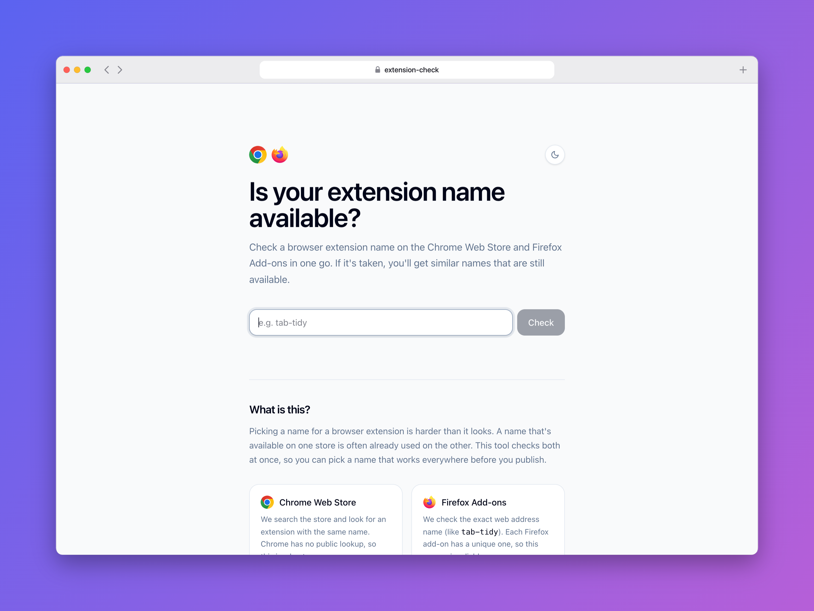

# Extension Name Checker

Check whether a browser extension name is free on the **Chrome Web Store** and
**Firefox Add-ons** at the same time. If it's taken on either, you get a list of
similar names that are still available on both.

A name that's free on one store is often already used on the other, so this
checks both before you commit to a name, a domain and a logo.

> **No AI, no account, no tracking.** Suggestions are simple, predictable
> variations of your name, and lookups are kept deliberately slow and cached so
> neither store gets hammered.



## Features

- **Both stores in one go.** Type a name and see Available, Taken or Couldn't
  check for Chrome and Firefox side by side, with a link to the listing that
  matched.
- **Similar names.** If the name is taken, it tries variations like
  `tab-tidy-pro`, `get-tab-tidy` and `my-tab-tidy`, and shows which ones are
  free on both stores.
- **Gentle on the stores.** Lookups run on the server with a 15 minute cache,
  and suggestions are checked one at a time with a pause between each.
- **Light and dark mode.** Follows your system setting, with a toggle that
  remembers your choice.

## How it checks

| Store | Method |
| --- | --- |
| Firefox Add-ons | **Exact.** Every add-on has a unique slug (`addons.mozilla.org/firefox/addon/<slug>/`), so it asks the AMO API whether that slug exists. |
| Chrome Web Store | **Best effort.** Chrome has no public lookup by name, so it searches the store and looks for a result whose name or slug matches yours. |

"Available" means no match was found. It doesn't reserve the name for you, and
Chrome results in particular are a strong hint rather than a guarantee.

## Getting started

```sh
bun install
bun run dev
```

Then open the URL Vite prints. npm works too: `npm install && npm run dev`.

| Command | What it does |
| --- | --- |
| `bun run dev` | Dev server with hot reload |
| `bun run build` | Production build into `.output/` |
| `bun run preview` | Serve the production build locally |
| `bun run test` | Run the tests (Vitest) |
| `bun run lint` | ESLint + Prettier |

## Deploying

The build targets **Cloudflare Workers** by default and writes a ready-to-use
`wrangler.json` alongside it:

```sh
bun run build
npx nitro deploy --prebuilt
```

The server side is built with [Nitro](https://nitro.build), so it can target
other hosts too. Set `NITRO_PRESET` when building, for example
`NITRO_PRESET=node-server bun run build` for a plain Node server or
`NITRO_PRESET=vercel` for Vercel.

## Project structure

```
src/routes/index.tsx         The page: search, results and suggestions
src/routes/__root.tsx        App shell, meta tags, 404 and error pages
src/lib/check.functions.ts   Server function that queries both stores, with the cache
src/lib/names.ts             Slugs, name variations and Chrome result parsing
src/server.ts, src/start.ts  SSR entry and error handling
src/test/                    Tests
```

Built with [TanStack Start](https://tanstack.com/start), React,
[Tailwind CSS](https://tailwindcss.com) and Vite.

## Credits

Interface guided by Emil Kowalski's
[Apple design notes](https://github.com/emilkowalski/skills/blob/main/skills/apple-design/SKILL.md).

Free and open source. Not affiliated with Google or Mozilla.
